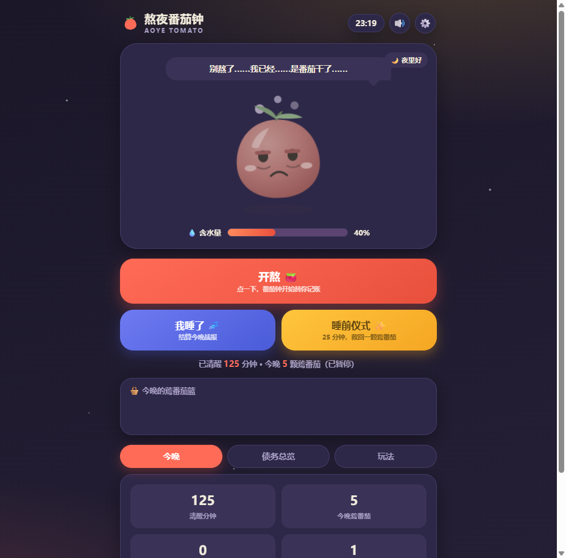
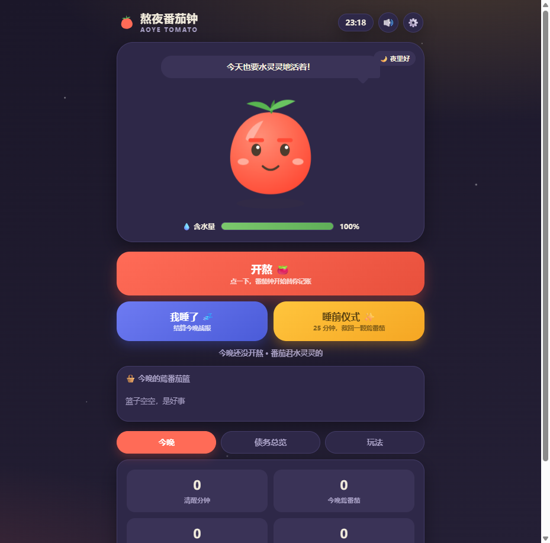
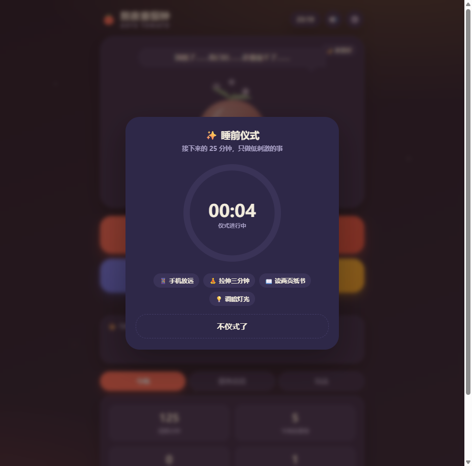
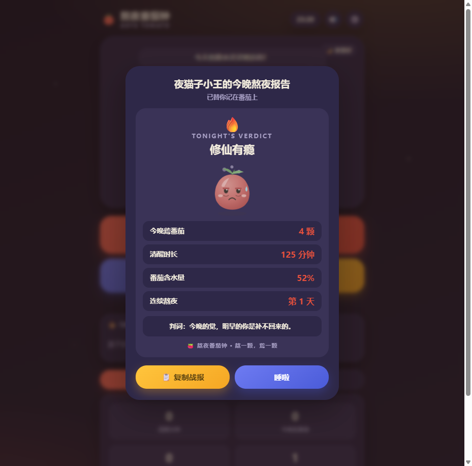

# 熬夜番茄钟 🍅

> 熬一颗，蔫一颗 —— 熬夜不是抽象的时间流逝，而是一颗颗看得见的蔫番茄。

**TRAE DEMO WALL · 1024 代码盲盒参赛作品**（命题：熬夜 × 番茄钟 × 可爱圆角风）

**在线体验**：https://mumuopen.github.io/aoye-tomato/ （评审试玩加速：链接后加 `?fast=1`，8 秒掉一颗番茄）

## 这是什么

- 点「开熬」后，每熬满一个番茄（25 分钟），掉落一颗**蔫番茄**：番茄君替你记账、替你变蔫，含水量从 100% 一路掉到 20%，从水灵灵蔫成黑眼圈、头顶冒烟的"番茄干"
- **金番茄机制**：完成 25 分钟「睡前仪式」倒计时，救回一颗蔫番茄——同一种番茄钟，白天用来工作，深夜用来告别今天
- 点「我睡了」生成《今晚熬夜报告》：称号、判词、连续熬夜天数、含水量，一键复制战报去晒

## 试玩

- **双击即玩**：直接打开 `index.html`（纯原生单文件、零依赖、断网可用）
- **演示模式**：网址后加 `?fast=1`，8 秒掉一颗番茄，不用干等 25 分钟

## 技术清单

- 纯 HTML/CSS/JS 单文件（约 48KB），无任何运行时依赖
- 番茄君：纯 SVG 分层动画 + CSS filter 六段衰减状态机
- 音效：Web Audio 现场合成（掉落"啵"声、仪式风铃，零音频素材）
- 数据：localStorage 本地持久化，番茄君不外传你的黑历史

## 截图

| 夜间首页（水灵态） | 番茄干状态 |
|---|---|
|  |  |

| 睡前仪式 | 今晚熬夜报告 |
|---|---|
|  |  |
