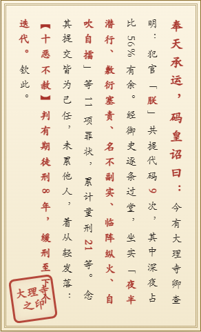
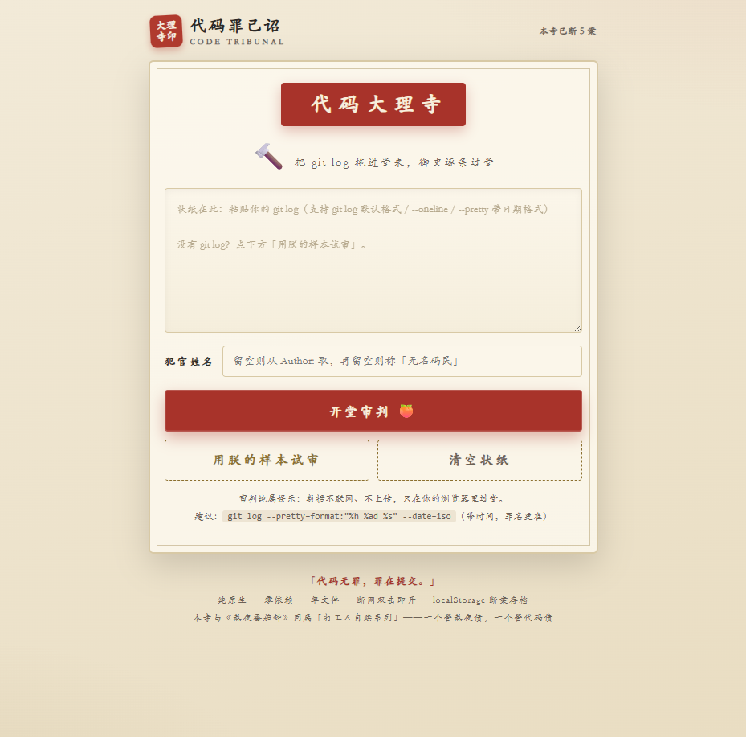
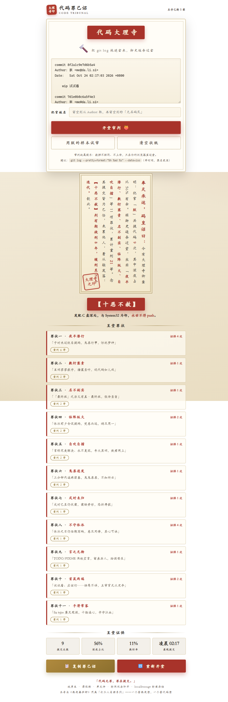

# 代码罪己诏 ⚖️

> 「代码无罪，罪在提交。」把你的 git log 拖进大理寺，看判几年。

**TRAE DEMO WALL 参赛作品** ·「打工人自赎系列」第二弹（前作：[熬夜番茄钟](https://traedemos.com/zh-CN/works/4839)——一个管熬夜债，一个管代码债）

**在线体验**：https://mumuopen.github.io/code-verdict/

## 这是什么

- 把 git log 拖进「代码大理寺」，御史逐条过堂：14 条文言罪名等你领——夜半潜行、敷衍塞责、出尔反尔、名不副实、临阵纵火（周五下午大提交）、鬼祟连发（三分钟连发三条）……
- 五级判决：良民 → 初犯 → 惯犯 → 江洋大盗 → 十恶不赦（发配 C 盘深处，永世不得 push）
- 结案生成盖着大理寺之印的**竖排罪己诏**（从右往左读，钦此结尾），一键复制战报去晒

## 试玩

- **双击即玩**：直接打开 `index.html`（纯原生单文件、零依赖、断网可用）
- 点「用朕的样本试审」直接看完整判决流程
- 支持三种 git log 格式：默认多行 / `--oneline` / `--pretty` 带日期；`Author:` 自动成为犯官姓名；也支持直接把日志文本拖进页面

## 技术清单

- 纯 HTML/CSS/JS 单文件（约 32KB），无任何运行时依赖
- 竖排圣旨：CSS `writing-mode: vertical-rl` + 双线框 + 红印章 + 盖印动画
- 罪名引擎：14 条正则规则 + 加权计分（每罪封顶，防误伤良民）
- 音效：Web Audio 现场合成的惊堂木与盖印声（零音频素材）
- 数据：只在浏览器本地（localStorage 断案存档），黑历史不上传

## 截图

| 公堂输入 | 判决全景 |
|---|---|
|  |  |
